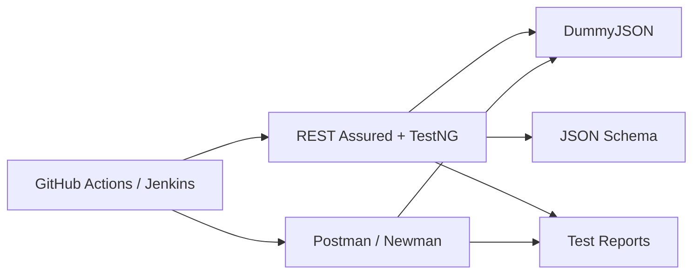

# API Test Automation Suite

[](https://github.com/YOUR_GITHUB_USERNAME/api-test-automation-suite/actions)


A portfolio API testing project that demonstrates **REST Assured, Postman, Newman, TestNG, Maven, JSON Schema Validation, and CI/CD** against a public test API.

## Highlights
- CRUD-style product API validation
- Authentication/token assertions
- Positive and negative scenarios
- Search and pagination tests
- Response-time check
- JSON schema/contract validation
- Postman collection + Newman headless execution
- REST Assured Java test suite
- GitHub Actions + Jenkins pipelines
- JUnit-compatible CI reports

## Architecture


## Tech Stack
`Java 17` · `REST Assured` · `TestNG` · `Maven` · `Postman` · `Newman` · `JSON Schema` · `GitHub Actions` · `Jenkins`

## Coverage
| Area | Scenarios |
|---|---|
| Products | get, list, search, create, update, delete |
| Auth | valid login, invalid login, missing password |
| Users | retrieve user, pagination |
| Contract | JSON schema validation |
| Non-functional | basic response-time assertion |

## Run REST Assured
```bash
mvn clean test
```
## Run Postman/Newman
```bash
npm install
npm run newman
```

## CI/CD
- GitHub Actions: `.github/workflows/api-tests.yml`
- Jenkins: `Jenkinsfile`

## Test Evidence
See `docs/screenshots/README.md`. 

## Structure
```text
src/test/java/
├── base/
└── tests/
src/test/resources/schemas/
postman/
docs/
test-cases/
.github/workflows/
Jenkinsfile
```

## What I practiced
API test design, reusable REST Assured assertions, authentication validation, negative testing, schema/contract testing, Newman CLI execution, CI/CD and test reporting.

## Important Note
DummyJSON simulates create/update/delete operations and does not permanently persist those changes. This makes it suitable for repeatable portfolio tests.
